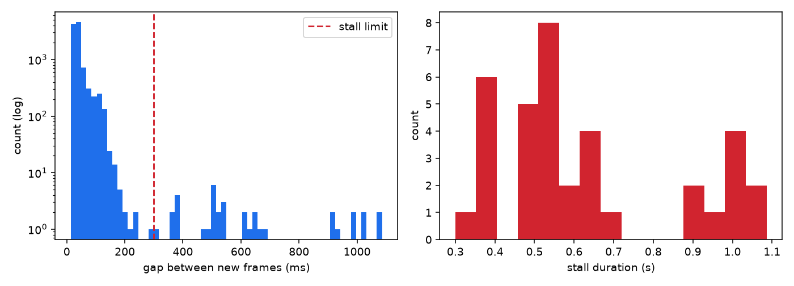

# Results (software only, on logs you already had)

Everything here comes from replaying or analyzing **existing** dronefollow frame logs and from synthetic fault injection. No new flight was made. Reproduce with:

```bash
python3 -m blackbox.analyze data/dronefollow_frames/*.jsonl --skip-start 2 --suggest --plot docs/figures/gaps.png
python3 -m blackbox.regress
python3 -m unittest discover -s tests
```

## 1. Frame-arrival timing on real Tello logs
First 2 s of each log skipped (startup). Source logs: your `dronefollow/flights/*/frames.jsonl` and `runs/ladder.jsonl` (the Oct 10 grounded test).

| Log | Frames | Seconds | FPS | Gap p50 / p90 / p99 / max (ms) | Stalls >300 ms | Stalls/min (95% CI) |
|---|---|---|---|---|---|---|
| calib1 | 1481 | 57.7 | 25.7 | 32.8 / 89.1 / 126.3 / 510.0 | 4 | 4.16 (1.13 to 10.66) |
| ladder | 2684 | 146.6 | 18.3 | 42.0 / 105.8 / 244.8 / 1086.0 | 26 | 10.64 (6.95 to 15.60) |
| room1 | 3022 | 105.2 | 28.7 | 32.7 / 57.7 / 95.9 / 1086.0 | 1 | 0.57 (0.01 to 3.18) |
| turning1 | 567 | 23.1 | 24.5 | 32.5 / 96.2 / 142.9 / 685.9 | 4 | 10.39 (2.83 to 26.60) |
| walk1 | 2833 | 97.1 | 29.2 | 33.3 / 44.8 / 74.9 / 991.9 | 1 | 0.62 (0.02 to 3.44) |



What the data says (observed):
- Typical frame gap is about 33 ms. Stalls are rare but large: 36 gaps over 300 ms, the longest 1.09 s.
- The ladder log stalls about 10 times a minute and runs at 18 fps, versus 0.6 per minute and 29 fps in room1 and walk1. The conditions differed between those runs; I did not check how. This spread is the main thing to explain.
- Stall durations are **not spread evenly**: they cluster around 0.4 to 0.7 s and again around 0.9 to 1.1 s, with nothing between about 0.72 and 0.88 s.
- The ladder run's video stopped for good at 148.6 s while the loop kept running until 182.5 s.

Hypothesis, **not a finding**: duration clusters like these could match a video decoder waiting for the next full keyframe after lost packets. Nothing here tests that. Section 3 of the plan (one-variable stall experiments) is how you would.

## 2. Watchdog regression suite (all pass)
Tick 50 ms. Thresholds: degraded 0.15 s, hover 0.30 s, land 2.0 s, recover 0.5 s, reverse limit 1.0 s.

| Check | Result | Detail |
|---|---|---|
| clean 20 fps stream: no HOVER or LAND | PASS | 0 trips |
| stall >= 0.35 s: HOVER within hover_s + 1 tick (40 trials) | PASS | 40/40; p50 300 ms, max 350 ms |
| stall of 4 s: LAND within land_s + 1 tick (10 trials) | PASS | 10/10; max 2050 ms |
| LAND stays latched after video returns | PASS | |
| 0.5 s stall: HOVER then NORMAL, never LAND | PASS | back to NORMAL 0.5 s after video resumed |
| sustained backward command: HOVER within max_reverse_s | PASS | HOVER at 1.05 s |
| forward command after reverse limit: NORMAL again | PASS | |
| 0.6 s latency step: HOVER | PASS | |
| replay deterministic (identical hash) | PASS | 5/5 logs |
| real logs: no LAND at default land_s | PASS | 0 LAND, 11 HOVER entries |
| real stream stop (ladder, no frames for 34 s): LAND | PASS | LAND 2.03 s after the last frame |

Notes and limits:
- **Detection latency is the threshold plus up to one tick.** A 0.3 s limit with a 50 ms tick means 300 to 350 ms.
- **Short stalls can slip between ticks.** The real logs contain 13 gaps over 300 ms (counting startup); the watchdog entered HOVER 11 times on the four flight logs. Gaps barely over the limit can fall between two ticks. That is a real property of polling.
- With land_s = 2.0 s the watchdog survives every real stall seen (max 1.09 s) and lands on the real stream stop. Whether 2.0 s is the right safety margin is your decision. `--suggest` prints 2.17 s as twice the longest gap.

## 3. What is NOT done
- **No flight was made and no new data was recorded.** The logger exists and is unit-tested but has not been attached to the live follower (see INTEGRATION.md).
- **The watchdog has never run on a real drone.** It passes tests on logged and injected data only.
- **The stall root cause is not found.** Section 1 describes the pattern, not the cause.
- **Replay covers frame timing and the commands you give it,** not the follower's detector or controller.
- **No Kalman filter yet** (weeks 11 to 12 of the plan), and no C++.
